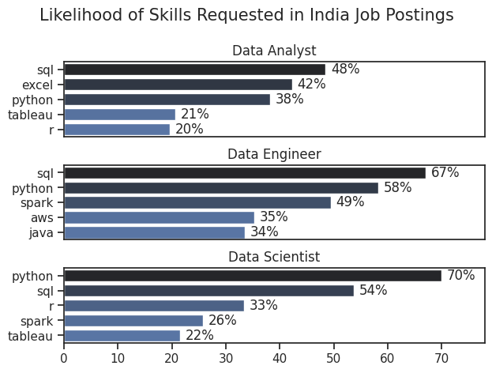
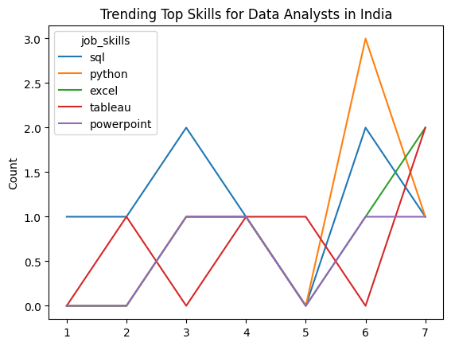
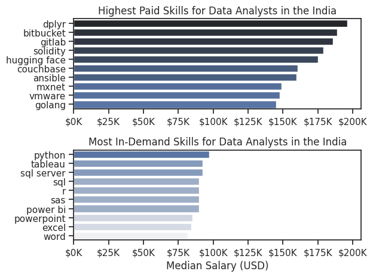
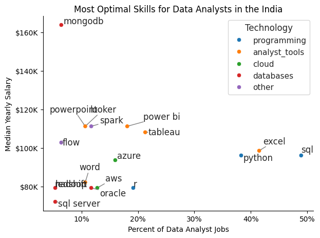

<h1 align="center">📊 Data Analyst Job Market Analysis</h1>

<p align="center">
  <b>Which skills are most in demand, how are they trending, and which ones pay the most?</b><br>
  An end-to-end exploratory analysis of data job postings using Python.
</p>

<p align="center">
  
  
  
  
  
</p>

<hr>

<h2>📑 Table of Contents</h2>

<ol>
  <li><a href="#overview">Overview</a><br></li>
  <li><a href="#questions">The Questions</a><br></li>
  <li><a href="#tools">Tools I Used</a><br></li>
  <li><a href="#structure">Project Structure</a><br></li>
  <li><a href="#preparation">Data Preparation and Cleanup</a><br></li>
  <li><a href="#analysis">The Analysis</a><br></li>
  <li><a href="#learned">What I Learned</a><br></li>
  <li><a href="#challenges">Challenges I Faced</a><br></li>
  <li><a href="#run">How to Run This Project</a><br></li>
  <li><a href="#conclusion">Conclusion</a></li>
</ol>

<hr>

<h1 id="overview">🔎 Overview</h1>

<h3>Welcome to my analysis of the data job market, focusing on data analyst roles.</h3>

<p>
This project was created out of a desire to navigate and understand the job market more effectively.
It delves into the <b>top-paying</b> and <b>in-demand</b> skills to help find optimal job opportunities for data analysts.
</p>

<h2>📦 About the Data</h2>

<p>
The data comes from a public data jobs dataset. It contains detailed information on job titles, salaries, locations, and essential skills.
Through a series of Python notebooks, I explore key questions such as the most demanded skills, skill trends over time, salary levels, and the intersection of demand and salary in data analytics.
</p>

<details>
  <summary><b>👉 Click to see what the dataset includes</b></summary>
  <br>
  <ul>
    <li><b>Job titles</b></li>
    <li><b>Salaries</b></li>
    <li><b>Locations</b></li>
    <li><b>Required skills</b></li>
  </ul>
</details>

<details>
  <summary><b>👉 Click to see what I explore</b></summary>
  <br>
  <ol>
    <li>The most demanded skills</li>
    <li>Skill trends over time</li>
    <li>Salary levels</li>
    <li>The intersection of demand and salary</li>
  </ol>
</details>

<br>

<h1 id="questions">❓ The Questions</h1>

<h3>Below are the questions I wanted to answer in this project:</h3>

<ol>
  <li><b>What are the skills most in demand for the top 3 most popular data roles?</b></li>
  <br>
  <li><b>How are in-demand skills trending for Data Analysts?</b></li>
  <br>
  <li><b>How well do jobs and skills pay for Data Analysts?</b></li>
  <br>
  <li><b>What are the optimal skills for Data Analysts to learn?</b> (High Demand AND High Paying)</li>
</ol>

<details>
  <summary><b>👉 Click to see how I answer each question</b></summary>
  <br>
  <ol>
    <li>
      <b>Skill demand by role:</b> I count how often each skill appears in the postings for the top 3 roles and show the top 5 skills for each.<br>
      📓 Notebook: <code>2_Skill_Demand.ipynb</code>
    </li>
    <br>
    <li>
      <b>Skill trends:</b> I group Data Analyst skills by posting month to see how demand changes through the year.<br>
      📓 Notebook: <code>3_Skills_Trend.ipynb</code>
    </li>
    <br>
    <li>
      <b>Salary analysis:</b> I compare median salaries across job titles and across skills.<br>
      📓 Notebook: <code>4_Salary_Analysis.ipynb</code>
    </li>
    <br>
    <li>
      <b>Optimal skills:</b> I plot demand against median salary to find skills that are both common and well paid.<br>
      📓 Notebook: <code>5_Optimal_skills.ipynb</code>
    </li>
  </ol>
</details>

<br>

<h1 id="tools">🛠️ Tools I Used</h1>

<h3>For my deep dive into the data analyst job market, I used these key tools:</h3>

<table align="center">
  <thead>
    <tr>
      <th align="left">Tool</th>
      <th align="left">Purpose</th>
    </tr>
  </thead>
  <tbody>
    <tr><td><b>🐍 Python</b></td><td>Backbone of the analysis</td></tr>
    <tr><td><b>🐼 Pandas</b></td><td>Data cleaning, filtering, grouping, and aggregation</td></tr>
    <tr><td><b>📊 Seaborn</b></td><td>Main library for all charts: bar plots, line plots, scatter plots</td></tr>
    <tr><td><b>📉 Matplotlib</b></td><td>Chart formatting, titles, and axes</td></tr>
    <tr><td><b>🏷️ adjustText</b></td><td>Non-overlapping labels on scatter plots</td></tr>
    <tr><td><b>📓 Jupyter / Google Colab</b></td><td>Running code with notes and visual output side by side</td></tr>
    <tr><td><b>💻 Visual Studio Code</b></td><td>Code editing and local execution</td></tr>
    <tr><td><b>🔀 Git &amp; GitHub</b></td><td>Version control and sharing the project</td></tr>
  </tbody>
</table>

<br>

<h1 id="structure">📁 Project Structure</h1>

```text
📦 data-analyst-job-market
 ┣ 📂 images/                         # The 4 charts used in this README
 ┣ 📓 1_EDA_Intro.ipynb               # Exploratory data analysis
 ┣ 📓 2_Skill_Demand.ipynb            # Most demanded skills for the top 3 roles
 ┣ 📓 3_Skills_Trend.ipynb            # Monthly skill trends for Data Analysts
 ┣ 📓 4_Salary_Analysis.ipynb         # Salary distributions and highest-paid skills
 ┣ 📓 5_Optimal_skills.ipynb          # Demand vs. salary: the optimal skills
 ┗ 📄 README.md
```

<br>

<h1 id="preparation">🧹 Data Preparation and Cleanup</h1>

<h3>This section outlines the steps taken to prepare the data for analysis, ensuring accuracy and usability.</h3>

<h2>📥 Import &amp; Clean Up Data</h2>

<p>I start by importing the necessary libraries and loading the dataset, then run initial cleaning tasks:</p>

<ol>
  <li>Convert <code>job_posted_date</code> into a proper <b>datetime</b> type.</li>
  <br>
  <li>Convert the <code>job_skills</code> column from a string into a real <b>Python list</b> using <code>ast.literal_eval</code>.</li>
</ol>

<details>
  <summary><b>👉 Click to see the code</b></summary>
  <br>
<pre><code class="language-python"># Importing Libraries
import ast
import pandas as pd
import seaborn as sns
import matplotlib.pyplot as plt

# Loading Data
df = pd.read_csv('data_jobs.csv')

# Data Cleanup
df['job_posted_date'] = pd.to_datetime(df['job_posted_date'])
df['job_skills'] = df['job_skills'].apply(lambda x: ast.literal_eval(x) if pd.notna(x) else x)
</code></pre>
</details>

<h2>🌍 Filter by Country</h2>

<p>
To focus the analysis on a single job market, I filter the dataset by country.
Notebooks <code>2</code>, <code>3</code> and <code>5</code> use <b>India</b>. Notebook <code>4</code> (salary analysis) uses the <b>United States</b>.
</p>

<details>
  <summary><b>👉 Click to see the code</b></summary>
  <br>
<pre><code class="language-python">df_India = df[df['job_country'] == 'India']
df_US    = df[df['job_country'] == 'United States']
</code></pre>
</details>

<br>

<h1 id="analysis">📈 The Analysis</h1>

<p>Each Jupyter notebook in this project investigates a specific aspect of the data job market. Here is how I approached each question.</p>

<h2>0️⃣ Exploratory Data Analysis</h2>

<p>📓 <b>Notebook:</b> <a href="1_EDA_Intro.ipynb">1_EDA_Intro</a></p>

<p>Before answering the main questions, I explored the dataset to see what it contains:</p>

<ul>
  <li>Number of jobs per job title</li>
  <li>Number of jobs per country (top 20)</li>
  <li>Number of jobs per company (top 20)</li>
  <li>Job benefits: work from home, degree requirement, and health insurance</li>
  <li>Data Analyst jobs in India: top 10 job locations</li>
</ul>

<hr>

<h2>1️⃣ What are the most demanded skills for the top 3 most popular data roles?</h2>

<p>📓 <b>Notebook:</b> <a href="2_Skill_Demand.ipynb">2_Skill_Demand</a></p>

<h3>Approach</h3>

<ol>
  <li>Filter jobs by country.</li>
  <li>Use <code>explode()</code> to turn each job's list of skills into one row per skill.</li>
  <li>Count how often each skill appears per job title.</li>
  <li>Convert counts to <b>percentages</b> by dividing by the total postings for that role, so the roles are comparable.</li>
  <li>Plot the top 5 skills for each of the top 3 roles.</li>
</ol>

<details>
  <summary><b>👉 Click to see the code</b></summary>
  <br>
<pre><code class="language-python">fig, ax = plt.subplots(len(job_titles), 1)

for i, job_title in enumerate(job_titles):
    df_plot = df_skills_perc[df_skills_perc['job_title_short'] == job_title].head(5)
    sns.barplot(data=df_plot, x='skill_percent', y='job_skills', ax=ax[i],
                hue='skill_count', palette='dark:b_r')

plt.show()
</code></pre>
</details>

<h3>Results</h3>

<p align="center">
  
</p>
<p align="center"><i>Seaborn bar charts of the top 5 skills (as a % of postings) for each of the top 3 data roles.</i></p>

<h3>💡 Insights</h3>

<ul>
  <li>📝 Which skill is the most requested for each role? Write the skill and its percentage from your chart.</li>
  <li>📝 How do the skills differ between roles?</li>
  <li>📝 Which skill appears across all three roles?</li>
</ul>

<hr>

<h2>2️⃣ How are in-demand skills trending for Data Analysts?</h2>

<p>📓 <b>Notebook:</b> <a href="3_Skills_Trend.ipynb">3_Skills_Trend</a></p>

<h3>Approach</h3>

<ol>
  <li>Filter Data Analyst postings.</li>
  <li>Extract the posting month with <code>dt.month</code>.</li>
  <li>Pivot the data so each row is a month and each column is a skill.</li>
  <li>Divide by the monthly total of postings to get the <b>likelihood of a skill in a posting</b>.</li>
  <li>Plot the top 5 skills as lines across the months of 2023.</li>
</ol>

<details>
  <summary><b>👉 Click to see the code</b></summary>
  <br>
<pre><code class="language-python">from matplotlib.ticker import PercentFormatter

df_plot = df_DA_India_percent.iloc[:, :5]
sns.lineplot(data=df_plot, dashes=False, legend='full', palette='tab10')

plt.gca().yaxis.set_major_formatter(PercentFormatter(decimals=0))
plt.show()
</code></pre>
</details>

<h3>Results</h3>

<p align="center">
  
</p>
<p align="center"><i>Seaborn line chart of the monthly likelihood of the top 5 skills in Data Analyst postings in 2023.</i></p>

<h3>💡 Insights</h3>

<ul>
  <li>📝 Which skill stays the most consistent through the year?</li>
  <li>📝 Which skill rises or falls the most?</li>
  <li>📝 Note any months with missing or sparse data, since small samples make the lines noisy.</li>
</ul>

<hr>

<h2>3️⃣ How well do jobs and skills pay for Data Analysts?</h2>

<p>📓 <b>Notebook:</b> <a href="4_Salary_Analysis.ipynb">4_Salary_Analysis</a></p>

<p>
I used only jobs that include <code>salary_year_avg</code> and compared the <b>median</b> salary, because the median is less affected by extreme outliers than the mean.
I first compared salary distributions for the 6 most common job titles with a box plot. Then I focused on Data Analysts and built two bar charts: the <b>10 highest-paid skills</b> and the <b>10 most in-demand skills</b>.
</p>

<details>
  <summary><b>👉 Click to see the code</b></summary>
  <br>
<pre><code class="language-python">fig, ax = plt.subplots(2, 1)

# Top 10 highest paid skills
sns.barplot(data=df_DA_top_pay, x='median', y=df_DA_top_pay.index,
            hue='median', ax=ax[0], palette='dark:b_r')

# Top 10 most in-demand skills
sns.barplot(data=df_DA_skills, x='median', y=df_DA_skills.index,
            hue='median', ax=ax[1], palette='light:b')

plt.show()
</code></pre>
</details>

<h3>Results</h3>

<p align="center">
  
</p>
<p align="center"><i>Top: highest-paid skills. Bottom: most in-demand skills, both by median salary.</i></p>

<h3>💡 Insights</h3>

<ul>
  <li>📝 Which skills pay the most? Check each skill's <code>count</code> first, because a high median based on very few postings is not reliable.</li>
  <li>📝 Which skills are the most in demand, and what do they pay?</li>
  <li>📝 How do the highest-paid skills differ from the most in-demand skills?</li>
</ul>

<hr>

<h2>4️⃣ What are the most optimal skills to learn for Data Analysts?</h2>

<p>📓 <b>Notebook:</b> <a href="5_Optimal_skills.ipynb">5_Optimal_skills</a></p>

<p>The optimal skills are the ones that are both <b>high demand</b> and <b>high paying</b>.</p>

<h3>Approach</h3>

<ol>
  <li>Count how many Data Analyst postings (with salary) mention each skill.</li>
  <li>Compute <code>skill_percent</code> (share of postings) and <code>median_salary</code> for each skill.</li>
  <li>Keep only skills present in <b>more than 5%</b> of postings.</li>
  <li>Group skills into technology categories and color the points by category.</li>
  <li>Plot demand (x-axis) against median salary (y-axis). Skills in the <b>top-right</b> are the best ones to learn.</li>
</ol>

<table align="center">
  <thead>
    <tr>
      <th align="left">Category</th>
      <th align="left">Skills</th>
    </tr>
  </thead>
  <tbody>
    <tr><td><b>Programming</b></td><td>Python, R, SQL</td></tr>
    <tr><td><b>Analyst tools</b></td><td>Excel, Tableau, Power BI, PowerPoint, Word, Visio</td></tr>
    <tr><td><b>Cloud</b></td><td>AWS, Azure, GCP</td></tr>
    <tr><td><b>Databases</b></td><td>SQL Server, MongoDB, Oracle, Redshift, MySQL, PostgreSQL</td></tr>
    <tr><td><b>Other</b></td><td>Spark, Hadoop, Flow, Zoom, and others</td></tr>
  </tbody>
</table>

<details>
  <summary><b>👉 Click to see the code</b></summary>
  <br>
<pre><code class="language-python">from adjustText import adjust_text

sns.scatterplot(
    data=df_DA_skills_tech_high_demand,
    x='skill_percent',
    y='median_salary',
    hue='technology'
)
plt.show()
</code></pre>
</details>

<h3>Results</h3>

<p align="center">
  
</p>
<p align="center"><i>Seaborn scatter plot of skill demand against median salary, colored by technology category.</i></p>

<h3>💡 Insights</h3>

<ul>
  <li>📝 Which skills sit in the top-right corner (high demand and high salary)?</li>
  <li>📝 Which skills are very common but pay less?</li>
  <li>📝 Which technology category clusters at the highest salaries?</li>
</ul>

<br>

<h1 id="learned">🎓 What I Learned</h1>

<ol>
  <li><b>Advanced Pandas:</b> <code>explode()</code>, <code>groupby()</code>, <code>pivot_table()</code>, <code>merge()</code>, and percentage calculations.</li>
  <br>
  <li><b>Data cleaning matters:</b> converting stringified lists and dates correctly is essential before any analysis.</li>
  <br>
  <li><b>Choosing the right chart:</b> bar charts for rankings, line charts for trends, scatter plots for trade-offs.</li>
  <br>
  <li><b>Strategic skill analysis:</b> demand and salary together say more than either one alone.</li>
</ol>

<br>

<h1 id="challenges">🧗 Challenges I Faced</h1>

<ol>
  <li><b>Data inconsistencies:</b> missing salary values and missing skill lists required careful filtering.</li>
  <br>
  <li><b>Small sample sizes:</b> some months and skills have few postings, which makes percentages and medians noisy.</li>
  <br>
  <li><b>Complex visualization:</b> keeping labels readable (for example with <code>adjustText</code>) and scales comparable across subplots.</li>
  <br>
  <li><b>Breadth vs. depth:</b> deciding how deep to go on each question without losing the big picture.</li>
</ol>

<br>

<h1 id="run">▶️ How to Run This Project</h1>

<h3>1. Clone the repository</h3>

```bash
git clone https://github.com/<your-username>/<your-repo-name>.git
cd <your-repo-name>
```

<h3>2. Install the requirements</h3>

```bash
pip install pandas seaborn matplotlib adjustText jupyter
```

<h3>3. Add the dataset</h3>

<p>Place the jobs CSV file in the project folder and update the file path in the first cell of each notebook.</p>

<h3>4. Run the notebooks in order</h3>

```bash
jupyter notebook
```

<h3>5. Save the 4 charts for this README</h3>

<p>Add one line after the chart in each notebook (2, 3, 4 and 5), using the file names below, and keep them in the <code>images/</code> folder:</p>

```python
plt.savefig('images/1_skill_demand.png', dpi=200, bbox_inches='tight')     # notebook 2
plt.savefig('images/2_skills_trend.png', dpi=200, bbox_inches='tight')     # notebook 3
plt.savefig('images/3_salary_skills.png', dpi=200, bbox_inches='tight')    # notebook 4
plt.savefig('images/4_optimal_skills.png', dpi=200, bbox_inches='tight')   # notebook 5
```

<br>

<h1 id="conclusion">✅ Conclusion</h1>

<p>
This exploration of the data analyst job market highlights the skills and trends that shape the field.
By combining <b>demand</b> (how often a skill is requested) with <b>pay</b> (the median salary), the analysis points to the skills that give the best return on learning time.
Job markets change quickly, so re-running these notebooks on fresh data is a good way to keep the findings current.
</p>

<hr>

<p align="center">⭐ If you found this project useful, please consider giving it a star!</p>
